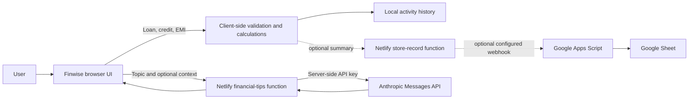

# Finwise

Finwise is a responsive, single-page financial decision support demo built with HTML, CSS, and JavaScript. It brings together a simplified loan readiness estimate, credit score interpretation, EMI calculation, and optional Claude powered educational tips.

## Run locally

Open `index.html` in a browser for the calculators and local history. To use the serverless integrations, install the Netlify CLI and run `netlify dev` from this folder. Configure the environment variables below in a local `.env` file or in Netlify. Do not commit secrets.

## Features

- **Loan eligibility:** validates income, age, self-reported credit score, employment type, existing obligations, and tenure. A transparent heuristic estimates a range using an assumed maximum debt-to-income share, score factor, employment factor, age factor, and a sample 12% annual rate.
- **Credit health:** maps a user-entered score into broad educational ranges and provides general ideas to review.
- **EMI calculator:** uses the standard fixed-rate amortizing payment formula and updates as the amount, rate, or term changes.
- **AI financial tips:** calls Anthropic through a Netlify Function. If the service is not configured or fails, the UI shows a clearly labeled set of general fallback tips.
- **Activity history:** keeps short summaries in browser local storage. It does not persist full loan form details.
- **Google Sheets:** optional summary-only record forwarding through a server-side Netlify Function and an Apps Script web app.
- **Privacy dialog:** explains local storage, optional network services, and deleting local history.

## Workflow

## Claude setup

Set these server-side environment variables in Netlify (or a local Netlify CLI environment):

| Variable | Purpose |
| --- | --- |
| `ANTHROPIC_API_KEY` | Anthropic API key. Keep this only in server-side environment settings. |
| `ANTHROPIC_MODEL` | Optional model override. Defaults to `claude-sonnet-5-5`. |

The function sends only the selected topic and optional free-text context (up to 500 characters). Do not put sensitive identifiers or account credentials into prompts.

## Google Sheets setup

This feature is opt-in and only sends activity summaries (`type`, `title`, `detail`, `value`, and timestamp). The server function does nothing when its environment variables are absent.

1. Create a Google Sheet and copy its ID from the URL.
2. Create an Apps Script project and paste in `google-apps-script/Code.gs`.
3. In Apps Script **Project Settings → Script Properties**, add `SHEET_ID` and a long random `FINWISE_TOKEN`.
4. Deploy the script as a web app that executes as you. Give access appropriate for your deployment, then copy the `/exec` URL.
5. Configure `GOOGLE_SHEETS_WEBHOOK_URL` with that URL and `GOOGLE_SHEETS_TOKEN` with the same random token in Netlify server-side environment settings.
6. Redeploy the Netlify site after setting variables.

The token is checked by Apps Script and stays between server-side services. The Apps Script deployment URL may be publicly reachable depending on the chosen access setting; use a strong token and a dedicated sheet. Google Apps Script writes are limited by Google's quotas.

## Deploy to Netlify

Connect this repository to Netlify with the publish directory set to `.`. `netlify.toml` already declares the publish directory and `netlify/functions`. Add environment variables in **Site configuration → Environment variables**, then trigger a deploy. Deploying the static files to Vercel is possible, but the included serverless functions use the Netlify Functions format and would need adapting to Vercel Functions.

## Validation and limitations

All numeric fields are range-checked in JavaScript. The loan estimate is a demo heuristic, not a lender model; it does not perform a credit inquiry and is not an offer or approval prediction. Credit ranges are broad educational labels, not bureau classifications. EMI assumes a fixed rate and excludes fees, taxes, and lender-specific compounding conventions. AI output may be incomplete or wrong and should not be treated as professional advice.

For a production financial service, add authentication, abuse controls/rate limiting, consent and retention controls for integrations, audit logging, server-side input/schema checks, accessibility review, formal security review, lender-specific disclosures, and a regulated model governance process. Future enhancements could add PDF reports, a validated ML model, user accounts, and explicit consent controls for each connected storage service.
